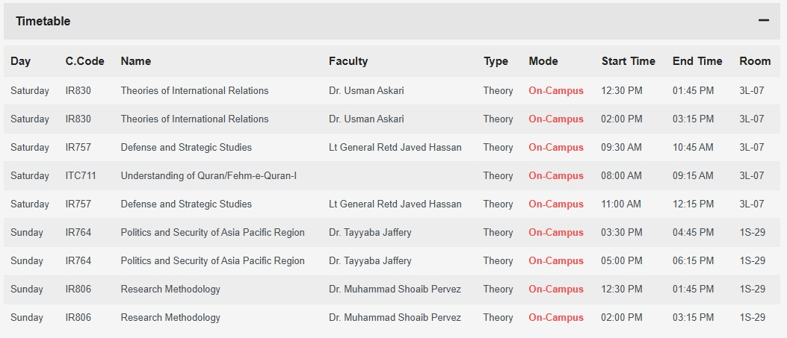

## Winters are approaching
---
This is **November** 2026, summers has gone **long** ago and autumn 🍁 is about to come to it's end.
The winters will start with a cool breez of air on a calm morning, when the sun will be rising from the surel horizon. The sleeping world which mostly never sees it will wake up to find everything has frozen up like 

```
MASHALLAH Kulfi khud bhi khayen aur apne bachon ko bhi khilayen.
```


{: width="1053" height="453" srcset="/source-assets/blog/2026/11/4ccaed36-de42-4442-818e-a103b5956989-384w.jpg 384w, /source-assets/blog/2026/11/4ccaed36-de42-4442-818e-a103b5956989-768w.jpg 768w, /source-assets/blog/2026/11/4ccaed36-de42-4442-818e-a103b5956989.jpg 1053w" sizes="(max-width: 760px) 100vw, 760px" }


It was never before, since time changes so the world moves along with it matching it's every little movements and steps. 
## A Fast world
Things are rapidly and inconsistently changing overtime, It's almost impossible to keep track of everything If you take a little moment to reflect on everything happening around you will miss the rat race of society, glowing glamours and the entitlements of today's world. So we don't! Until the day ends and sun starts to slowly fade away deep below the horizon, anyone watching it from distance will finally realize things should have been slower exactly like nature does.
